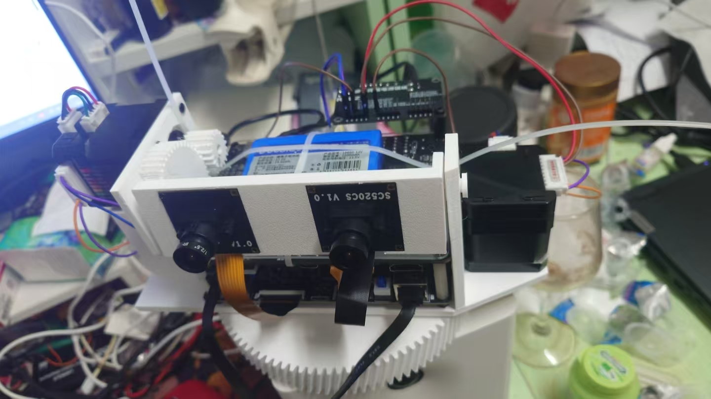
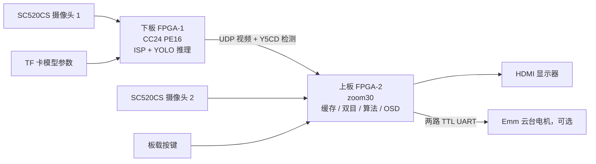

# 双目 YOLO 视觉处理系统 · 双 FPGA 开源工程

**2026 年 FPGA 安路二被肘击纪念**

两块安路 HX1P35A 开发板、两路 SC520CS 摄像头：一块负责 YOLO 硬件推理与视频发送，另一块负责视频融合、40 种可切换图像模式、双目视觉、目标跟踪、HDMI 显示及云台控制。

> **演示视频：[【2026年FPGA安路二被肘击纪念-双目YOLO视觉处理系统】](https://www.bilibili.com/video/BV1z1Wg6REoi/)**
>
> 点击下面的实物图前往 B 站观看。GitHub README 不支持直接嵌入 B 站播放器。

[](https://www.bilibili.com/video/BV1z1Wg6REoi/)

本仓库以 **2026-11-01 参赛交付快照**为基线：上板 **zoom30**，下板 **CC24 PE16**。保留原始生产 RTL、约束、构建 TCL、双板 bit 和部分仿真源码；增加中文导读、构建迁移工具与文件校验清单。不是后来单模式云台实验的混合版本。

## 从哪里开始

| 想做什么 | 入口 |
|---|---|
| 先看实际效果 | [B 站演示](https://www.bilibili.com/video/BV1z1Wg6REoi/) |
| 找到上板、下板代码 | [上板工程](FPGA_two_boards_20261101/upper_FPGA2_zoom30/project/) / [下板工程](FPGA_two_boards_20261101/lower_FPGA1_CC24_PE16/project/) |
| 查看全部模式及编号 | [40 模式说明](docs/MODES.md) |
| 准备软件、迁移路径、编译 | [构建与复现](docs/BUILD.md) |
| 接线、按键、启动系统 | [硬件与操作](docs/HARDWARE.md) |
| 理解板间通信、YOLO 格式 | [架构与协议](docs/ARCHITECTURE.md) |
| 查看真实资源、时序及局限 | [验证与资源报告](docs/VALIDATION.md) |
| 核对原版 bit | [SHA-256 清单](SHA256SUMS.txt) |

## 系统做了什么

- **本地图像流水线**：灰度、二值化、通道提取、亮度/对比度、Gamma、均值/高斯滤波、锐化、梯度、形态学、浮雕、素描、卡通等，复用窗口与像素处理硬件。
- **双板视频链路**：下板摄像头视频以 UDP 发送，上板解析、缓存并与本地摄像头图像组合，输出 HDMI。
- **YOLO 检测**：下板采用固定图的 FPGA 推理实现；上板接收类别、置信度与框坐标，显示 PERSON / CAR / CHAIR / BOTTLE 标签和检测框。显示链路与推理链路帧率分别统计，不能把视频帧率当作检测帧率。
- **双目视觉**：双目显示、局部目标测距及视差深度可视化。测距表与安装标定相关，移植到另一组镜头或基线后必须重新标定。
- **目标跟踪**：按键捕获灰度模板，使用真实像素匹配；颜色模式按 RGB 色差分割并提取区域；运动模式计算跨帧变化并绘制区域框。三者具有不同计算逻辑。
- **交互与监测**：按键切换、安路 Logo、状态文字、帧计数、显示新帧率、UDP 接收帧率/带宽和内部视频链路延迟显示。
- **云台接口**：保留双路 Emm TTL 串口跟随接口。是否启用由按键与跟踪状态控制；电机安装、方向、供电与机械活动范围需要按实际硬件核对。

## 双板分工



“上板/下板”指本项目角色，不依赖开发板摆在桌面的左侧或右侧。**FPGA-1 是 YOLO 发送板，FPGA-2 是 HDMI 接收/处理板。**

## 版本与资源

器件为 **PH1P35MDG324，speed 3**；原构建工具为 **Anlogic TD V6.2.168116**。

| 最终布局布线报告 | 上板 zoom30 | 下板 CC24 PE16 |
|---|---:|---:|
| Slice | 20,592 / 21,216（97.06%） | 20,233 / 21,216（95.37%） |
| LUT6 | 19,773 | 19,039 |
| 寄存器 | 19,376 | 19,206 |
| ERAM | 108 / 108 | 106 / 108 |
| DSP | 35 / 40 | 40 / 40 |
| I/O | 75 | 73 |
| Setup WNS | +0.114 ns | +0.101 ns |
| Hold WNS | +0.020 ns | +0.020 ns |

以上取自对应生产目录保存的最终报告，详见 [证据与适用范围](docs/VALIDATION.md)。**本次开源整理没有重新运行综合、布局布线或板测。** 两块板资源占用均较高，增加算法不能只看 RTL 行数，仍需重新评估存储和布线资源。

## 仓库结构

```text
FPGA_two_boards_20261101/
  README.txt                     原交付说明
  upper_FPGA2_zoom30/
    bitstream/                   上板原版 bit
    project/                     顶层、RTL、IP、ADC/SDC、四阶段 TCL
    simulation/                  延迟、三缓冲、模板匹配等测试源码
  lower_FPGA1_CC24_PE16/
    bitstream/                   下板原版 bit
    project/
      cc24_perf_20261031/input4/  下板顶层、推理/TF/视频 RTL、构建脚本
      il3/source_snapshot/       摄像头与基础 IP 依赖
docs/                            中文说明、实物图、原始资源/时序报告
tools/prepare_build.py           创建独立构建副本并迁移绝对路径
SHA256SUMS.txt                    源码快照、补充 ROM 与 bit 文件校验
```

## 快速开始

```powershell
git clone https://github.com/niconiconi-nico/fpga-binocular-yolo-2026.git
cd fpga-binocular-yolo-2026
python tools/prepare_build.py --output build/local
```

此命令只复制工程、替换历史绝对路径并检查构建输入，不调用 TD、不烧录、不控制电机。随后按 [BUILD.md](docs/BUILD.md) 在 TD 环境中分别执行双板构建阶段。

已有 bit 位于两个 `bitstream/` 目录。请先核对板型、两块板的角色与文件 SHA-256；原始 `README.txt` 中的 Flash 烧录记录只是历史交付记录，本仓库工具不会自动写入 Flash。

### 复现前必须知道

1. **TF 模型权重未包含在原交付源码包中，本仓库当前也未提供模型权重或训练数据。** 下板 RTL 在启动时从 TF 卡读取模型；仅有 bit 不能保证复现 YOLO 检测。模型格式、长度与固件须配套，不能直接放一个 `.pt` 文件替代。
2. 原压缩包遗漏了下板的 4 个综合 ROM 初始化文件，本仓库已从对应 `input4/whole1` 补齐，详见 [构建说明](docs/BUILD.md)。它们不是完整模型权重。
3. 厂商加密 IP、参考设计及其版权声明保留。原创部分与第三方部分的许可边界见 [LICENSE](LICENSE) 和 [THIRD_PARTY_NOTICES.md](THIRD_PARTY_NOTICES.md)。不宣称所有依赖均为可自由重授权的开源实现。
4. OSD 的 LAT 是 FPGA 内部采集标记到显示帧选择的测量，不包含液晶面板扫描/响应时间，不能当作光学端到端延迟。

## 致谢与交流

感谢安路科技的 FPGA 工具与 IP、开发板/摄像头参考设计，以及米联客相关基础模块。项目保留原始作者和工具生成的版权头。

欢迎通过 Issues 讨论源码、复现、资源优化与算法效果。提交问题时请附上板卡角色、源码版本、TD 版本、模式屏幕编号/内部编号和日志；修改约束或硬件后请提供新的时序与验证结果。

**视频入口：[双目 YOLO 视觉处理系统 · Bilibili](https://www.bilibili.com/video/BV1z1Wg6REoi/)**
