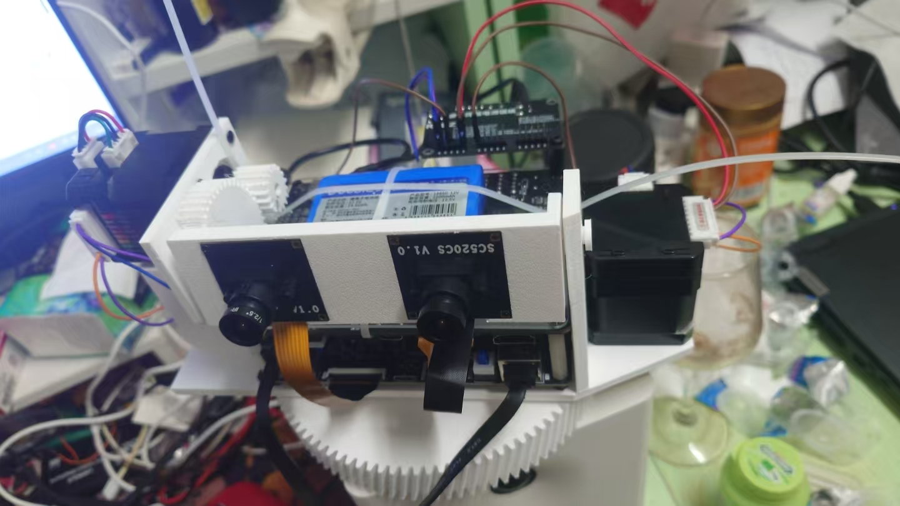

# 硬件与操作

## 设备与连接

- 两块安路 HX1P35A 开发板，工程器件 PH1P35MDG324、speed 3。
- 两路 SC520CS 摄像头，分别连接各板对应 MIPI 接口。
- 下板 FPGA-1 通过以太网将视频/YOLO 结果发送给上板 FPGA-2；上板 HDMI 连接显示器。
- 下板 TF 卡保存固件匹配的模型数据，模型文件不是本仓库的四个综合 ROM。
- Emm 固件 TTL 串口电机为可选外设；电机主电源单独供电，信号地与 FPGA 共地，TX/RX 交叉连接。

## 按键与模式

上板 `stereo.adc` 和 `modes/mono_keys1.sv` 对应关系：

| 按键 | FPGA 封装脚 | 顶层信号 | 行为 |
|---|---|---|---|
| K1 | D5 | `I_mode_key_n[0]` | 下一模式 |
| K2 | A9 | `I_mode_key_n[1]` | 上一模式 |
| K3 | B9 | `I_mode_key_n[2]` | 普通短按释放返回原图；可跟随模式长按约 1 s 启用 FOLLOW |
| K4 | C7 | `I_capture_key_n` | 当前模式的捕获/选择/缩放操作 |

按键低有效、消抖，模式在显示帧边界生效。默认内部模式 37，即屏幕 **33 STEREO**。屏幕序号和 RTL ID 见 [MODES.md](MODES.md)。

FOLLOW 已启用时，按任一模式键首先触发停止，不在同一次按键直接切换模式。TEMPLATE 中 K4 长按约 0.6 s 捕获当前模板，锁定后短按解除；普通选择与不同模式附加行为以 `range_meter.sv`、`zoom_ctrl.sv`、`color_cells.sv` 和顶层逻辑为准。

典型演示流程：

1. 接好两路摄像头、板间网线、上板 HDMI、下板配套 TF 卡，给两块板正常供电。
2. 核对两板 bit 的角色和 SHA，使用对应工具加载；先检查本地图像，再检查 STEREO 的远端视频。
3. 切到 YOLO ONLY，等待模型就绪和检测结果。视频有画面不代表模型已成功加载。
4. TEMPLATE 中把有纹理的目标放入框，长按 K4 捕获，观察 LOCK/LOST 等状态。
5. 需要演示云台时才在安装方向与可动范围确认后启用 FOLLOW。单纯视觉演示不需要接电机或开启跟随。

## 电机接口以约束为准

当前双板提交版 ADC 中：

| FPGA 信号 | 封装脚 | 接线方向 |
|---|---|---|
| `O_left_tx` | P4 | FPGA TX → 左路电机 RX |
| `I_left_rx` | P6 | FPGA RX ← 左路电机 TX |
| `O_right_tx` | J15 | FPGA TX → 右路电机 RX |
| `I_right_rx` | J13 | FPGA RX ← 右路电机 TX |

**这些是 FPGA 封装脚号，不是排针针序。** J1/J2 从正面或背面观察可能镜像；请对照自己板卡版本的官方原理图/丝印确认排针序号和 GND，不依据照片左右方向猜线。本仓库未将历史聊天里的排线颜色作为电气定义。

使用匹配电平的 TTL UART，不接 RS232 电压，也不直接把 RS485 A/B 接到 FPGA。两个独立串口上的地址是否相同由具体控制器命令决定；移植时检查 `gimbal_mc.sv`，不要把另一版双云台上位机地址配置当作本版本配置。

## 常见现象

| 现象 | 优先检查 |
|---|---|
| 有 UI 没有摄像头图像 | 摄像头排线、供电、初始化、MIPI/DDR 状态；不要只看 OSD 就认为采集正常 |
| 本地正常，远端黑屏 | 下板启动、网线、网络配置、分片/完整帧接收统计 |
| 远端视频正常，没有检测框 | TF 模型与就绪状态、检测帧号、置信度、Y5CD 接收；视频和推理是不同链路 |
| 模板跳动或丢失 | 弱纹理、重复图案、遮挡、速度超过局部搜索范围、曝光变化 |
| 测距不准 | 镜头/基线/姿态是否仍匹配标定，左右曝光时刻与纹理是否满足要求 |
| FOLLOW FAULT | 保留具体 P/Y/C 状态和串口回包，按源码解码；不是所有 FAULT 都表示机械堵转 |
